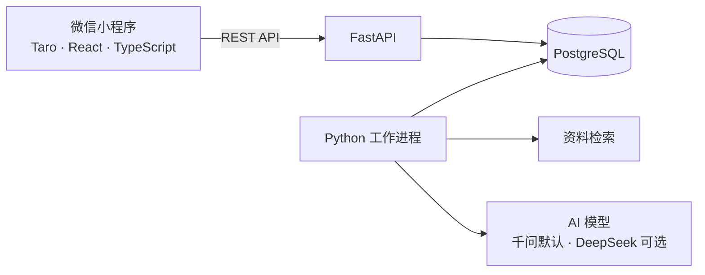

# 轻知闯关

轻知闯关是一款微信小程序学习应用：输入感兴趣的主题，生成有资料依据的练习题，逐题作答并查看讲解；答完后可以回顾学习记录、错题和收藏，并查看 AI 学习总结。


## 功能

- 输入主题并异步生成 12 道练习题，展示生成阶段和用时。
- 单选、多选、判断逐题答题，查看答案、讲解和资料出处。
- 保存主题、答题进度、学习记录、错题、收藏和金币。
- 完成练习后生成 AI 学习总结，可从结果页和学习记录中查看。
- 微信登录；本地开发可启用开发会话。

## 技术结构



| 目录 | 内容 |
| --- | --- |
| `frontend/` | Taro 微信小程序、页面、组件及 API 客户端 |
| `backend/app/api/` | FastAPI 路由和接口模型 |
| `backend/app/domain/` | 答题、题组校验和业务规则 |
| `backend/app/worker/` | 异步出题、资料检索和 AI 总结工作进程 |
| `backend/alembic/` | 数据库迁移 |
| `docs/` | 需求、方案设计和运行验收文档 |

## 本机运行

需要 Docker Compose、Node.js 20.18 或更高版本、npm、Python 3.12，以及 [uv](https://docs.astral.sh/uv/)。

### 启动数据库和后端 API

在仓库根目录执行：

```bash
docker compose up -d --wait postgres
cd backend
cp -n .env.example .env
uv sync --locked
uv run --locked alembic upgrade head
uv run --locked uvicorn app.main:app --host 127.0.0.1 --port 8000
```

本地数据库默认监听 `127.0.0.1:55432`，API 文档地址为 <http://127.0.0.1:8000/docs>。后端设置见 `backend/.env.example`；配置微信登录、模型或检索服务时，将对应凭证填入本机 `backend/.env`，不要提交密钥。

### 启动 AI 工作进程

另开一个终端，在仓库根目录执行：

```bash
cd backend
uv run --locked python -m app.worker
```

出题和 AI 学习总结由工作进程处理。默认模型供应商为千问；所需 API 密钥及 DeepSeek 备选配置见 `backend/.env.example`。

### 启动小程序

另开终端，在仓库根目录执行：

```bash
cd frontend
npm ci
QINGZHI_DEV_AUTH=1 npm run dev:weapp
```

微信开发者工具导入 `frontend`，项目运行目录指向 `frontend/dist`。本地 API 地址默认为 `http://127.0.0.1:8000`。开发者工具中允许本地服务请求；开发会话仅用于本地调试。

生产构建需使用 HTTPS API 地址和小程序 AppID：

```bash
cd frontend
TARO_APP_ID=wx-your-app-id QINGZHI_API_BASE_URL=https://api.example.com npm run build:weapp
```

## 常用命令

```bash
# 前端
npm --prefix frontend run typecheck
npm --prefix frontend test

# 后端
(cd backend && uv run --locked pytest --cov=app --cov-branch --cov-report=term-missing)
(cd backend && uv run --locked alembic check)
(cd backend && uv run --locked ruff check . && uv run --locked ruff format --check .)
```

后端端到端冒烟验证需要本地 API、数据库及相应服务配置：

```bash
(cd backend && uv run --locked python scripts/smoke.py --topic '光合作用原理')
```

## 文档

- [方案设计文档](docs/方案设计文档.md)
- [最终版本需求分析文档](docs/最终版本需求分析文档.md)
- [运行与验收](docs/运行与验收.md)
