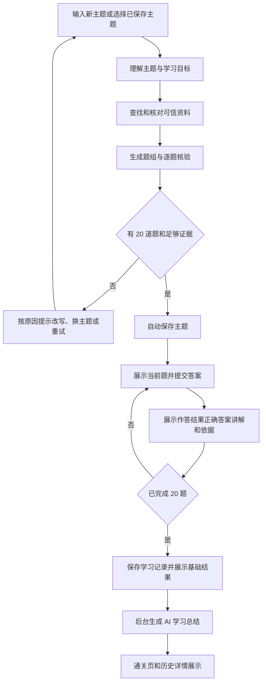
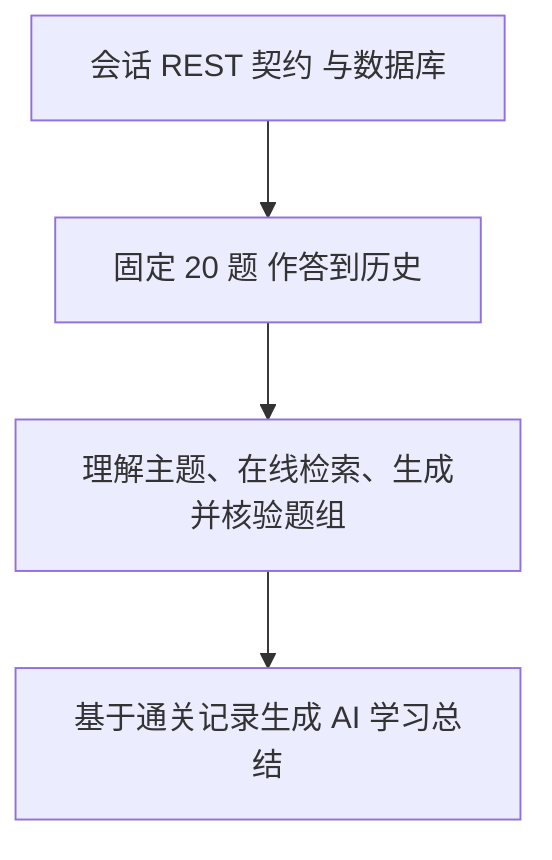
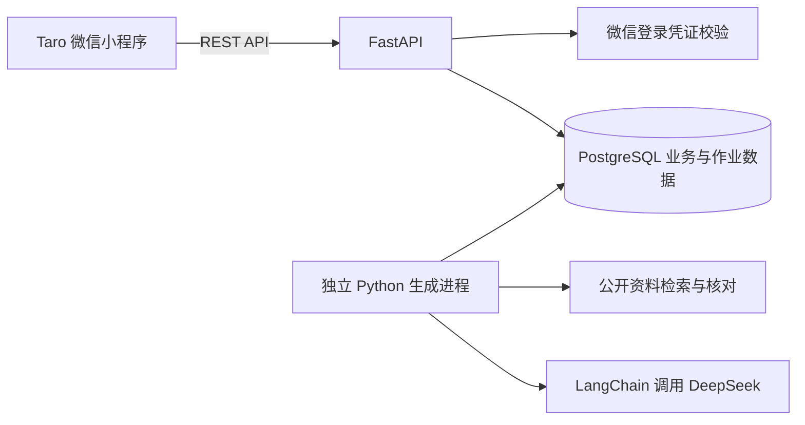

# 轻知闯关 方案设计文档

**版本** v2.0　·　**更新日期** 2026-11-25　·　**运行平台** 微信小程序　·　**范围** 首版项目实现

轻知闯关把用户选择的学习主题变成 20 道有依据的练习题。用户逐题作答并查看讲解，通关后立即看到基础结果。AI 学习总结随后结合本次作答生成，供本人复习。产品规则以[最终版本需求分析文档](最终版本需求分析文档.md)为准。

**技术方案**采用 Taro + React + TypeScript 小程序和独立的 FastAPI 后端，通过 REST API 连接。PostgreSQL 保存业务数据与生成任务，独立 Python 工作进程调用服务端检索接口获取资料，并使用 LangChain 和 DeepSeek 理解学习意图、生成及核验题组。出题通过后自动保存主题，通关后沿用学习记录和总结流程。

**目录**

1. [首版范围与用户流程](#1-首版范围与用户流程)
2. [项目实现流程](#2-项目实现流程)
3. [技术选型与系统架构](#3-技术选型与系统架构)
4. [核心业务设计](#4-核心业务设计)
5. [数据、接口与权限](#5-数据接口与权限)
6. [附录](#6-附录)

## 1 首版范围与用户流程

### 1.1 MVP 功能范围

| 能力 | 首版行为 | 需求编号 |
| --- | --- | --- |
| 主题输入与依据 | 输入主题或问题，或选择已保存主题。新主题现场理解意图并检索可信资料，讲解展示出处 | M01、M03–M04 |
| 出题与答题 | 每组固定 20 题。单选、多选、判断各至少 1 题。逐题提交，每题展示用户答案、完整正确答案、讲解和依据 | M05–M07 |
| 已保存主题 | 题组核验成功后自动保存到当前用户的主题列表，同一主题只显示一个入口 | M17 |
| 出题进度 | 展示真实阶段与已用时间，支持返回首页并稍后查看同一个任务 | M18 |
| 通关与记录 | 答完 20 题即通关，自动保存主题、完成时间、答对题数、知识总结和错题。历史可再次打开 | M08–M10 |
| AI 学习总结 | 通关记录保存后自动生成知识回顾、实际易错点和复习建议。结果写入历史，仅本人查看 | M16 |

学习材料粘贴与 RAG、生命值、好友分享、题目纠错反馈、隐私说明页面和学习记录删除列入后续扩展，见附录。AI 生成的题目、讲解及总结展示生成标识。

### 1.2 从输入到通关复习



## 2 项目实现流程

项目先用固定题跑通**题组、作答和记录**，再接入主题出题，两条路径都返回 `quizId`。通关返回的 `recordId` 用于查看历史和读取 AI 学习总结。



### 2.1 应用骨架与题组契约

1. **数据库与服务端。** 建立用户、会话、题组、作答尝试、答题回执和学习记录的表结构，以及题组外键所需的最小生成作业结构。定义内部题组结构、可发给前端的 `QuestionView`、作答后的 `AnswerReceipt` 和完成后的 `RecordView`。`QuestionView` 只含题型、题干和选项，正确答案和讲解从作答回执返回。
2. **前端接入。** 实现应用入口、页面路由、统一请求层和会话管理。用 OpenAPI 同步接口类型。第一阶段可以由本地登录适配器取得会话，后续接入微信登录时继续使用相同的 `user_id` 归属和会话校验机制。
3. **固定题组入口。** 准备一组含单选、多选和判断的 20 道题，附讲解、证据及总结。仅在本地开发模式注册固定题组路由。该路由用内部 `FIXED` 来源为当前用户建立已完成的作业和题组，跳过工作进程，返回正常答题接口所需的 `quizId`。

### 2.2 固定 20 题与学习记录

1. **开始答题。** 小程序用 `quizId` 调用 `POST /v1/attempts`，后端创建尝试并返回 `attemptId` 与当前题。题卡根据题型渲染单选、多选或判断选项。
2. **提交和讲解。** 小程序用 `attemptId` 和 `questionId` 提交所选项。后端在事务内锁定尝试、判分并写入首次回执。页面收到回执后显示对错、正确答案、讲解和依据。用户点击继续后，活动中的尝试读取下一道题。
3. **通关和历史。** 末题提交在同一事务内写入回执、通关状态和学习记录。小程序凭 `recordId` 打开总结，从历史列表点进记录也使用同一个详情接口。重复提交读取既有回执，历史记录保留同一份。

### 2.3 主题输入与异步出题

1. **主题入口。** 首页用 `GET /v1/topics` 展示当前用户已保存的主题。用户手动输入时提交 `topic`，点主题卡时提交 `topicKey`。API 校验入参和归属、预留配额并返回 `jobId`。新主题直接入队，工作进程现场理解意图和检索；已保存主题可优先复用足够且仍适用的资料。
2. **证据与模型。** 检索后确认资料来自可核对的公开来源，保存原文片段和出处，再交给出题与核验流程。Pydantic 及题组规则校验输出，逐题内容核验通过才交付。
3. **进度与恢复。** 首次提交立即反馈，状态接口返回后台实际阶段和创建时间。前端显示「理解主题」「查找和核对资料」「生成题目」「核验答案与讲解」以及已用时间。等待较久时显示当前阶段与稍后查看入口。前端按当前会话保存待查看任务，在首页或重进应用后重新读取状态。未取得 `jobId` 时沿用原幂等键恢复提交。预计时间基于实测，缺乏数据时只显示已用时间。
4. **自动保存与答题。** 工作进程在同一事务内写入题组、保存或更新主题，并将任务标记为成功。等待页保持打开时直接进入答题；用户已离开时，从首页的作业入口继续。资料不足、范围不清、超时和暂时性服务故障显示不同提示，失败任务不新增主题。

### 2.4 AI 学习总结

1. **从通关写入任务。** 新增 `record_ai_summaries`，在通关写入基础记录时一并创建 `QUEUED` 行。末题提交只负责落库和返回 `recordId`。重复提交沿用原记录和总结任务。
2. **从作答生成复盘。** 在工作进程增加总结任务处理，用本次记录快照调用独立的 LangChain 总结链，校验后写入知识回顾、实际错题对应的易错点和复习建议。
3. **在两处展示。** 通关页与历史详情复用 AI 学习总结组件。先渲染基础结果，进入页面时读取 `GET /v1/records/{id}`，只在待处理状态轮询。成功时展示结果和 AI 生成标识，可恢复的失败状态显示重试按钮。重试沿用原记录。

## 3 技术选型与系统架构

### 3.1 小程序框架对比

以下比较以微信小程序和独立 HTTP 后端为前提。三种方案都可连接同一套 API，主要差异在于页面开发方式、微信能力接入和跨端适配成本。

| 维度 | 原生微信小程序 + TypeScript | uni-app + Vue 3 + TypeScript | Taro + React + TypeScript |
| --- | --- | --- | --- |
| 微信能力接入 | 直接调用 `wx.*`，微信专有能力的适配路径最短 | 跨端 API 配合条件编译，微信专有行为按平台适配 | `Taro.login` 和 `Taro.request` 集中封装，微信专有行为由 `weapp` 适配层处理 |
| 工程复杂度 | 依赖层较少，需要使用 WXML、WXSS 和微信页面模型 | 使用 Vue 组件及 uni-app 编译配置处理平台差异 | 使用 React 组件及 Taro 编译链生成微信小程序产物 |
| 页面实现 | 原生表单、滚动容器和结果组件 | Vue 模板和组件适合组织表单、题卡和页面状态 | 用 React 组件和 Hooks 组织选项、答题回执、页面生命周期及请求状态 |
| 跨端复用 | 服务端 API 可复用，其他端页面另建 | Vue 项目扩展到 H5 或其他小程序时可复用部分页面 | React 项目扩端时可复用组件与请求层，登录和存储按平台适配 |

**选用 Taro、React 和 TypeScript**，首版仅面向微信小程序，使用 `Taro.request` 封装访问令牌、错误映射与重试。页面负责交互状态，FastAPI 负责判分、出题规则和数据权限。根据 FastAPI 的 OpenAPI 契约生成 TypeScript DTO，接口变更时同步更新。小程序复用选项、进度、讲解和证据组件。[Taro 官方仓库](https://github.com/NervJS/taro) · [DCloud uni-app 文档](https://uniapp.dcloud.net.cn/) · [微信小程序官方示例](https://github.com/wechat-miniprogram/miniprogram-demo)

用锁文件管理 Taro、React 和构建依赖。微信登录与本地存储由适配层封装，业务页面通过统一请求层访问 API。

### 3.2 后端框架对比

后端要提供微信登录、作答、历史和生成状态接口，并把模型请求交给独立工作进程。框架选择主要影响 API 契约的维护方式、业务规则能否和工作进程共享，以及后续是否需要管理后台。

| 候选 | API 与数据校验 | AI 工作进程 | 对本项目的取舍 |
| --- | --- | --- | --- |
| FastAPI + Pydantic | 依据 Python 类型与请求、响应模型生成 OpenAPI，供 Taro 同步接口类型 | API 与 Python 工作进程可复用 Pydantic 模型和领域校验器 | 需单独选择 ORM 与迁移工具。适合当前 REST API、答题规则与 AI 生成并存的结构 |
| Django + Django REST Framework | 通过 Serializers 定义接口表示与校验，使用 Django ORM、迁移和 Admin 管理数据 | 可与 Python 模型工作进程共享领域逻辑 | 已有 Django 项目或需要借助 Admin 管理大量内容时更合适。首版主题随成功作业自动保存，暂不建设管理后台 |
| NestJS + TypeScript | 以控制器和 DTO 定义 API，可用 `@nestjs/swagger` 生成 OpenAPI | 保留 Python LangChain 时需增加进程间契约，也可用 Node.js 重新实现模型适配 | 前后端可共用 TypeScript。若采用当前 Python 工作进程，则需在两个运行时维护接口和校验边界 |

**首版采用 FastAPI + Uvicorn + Pydantic。** API 进程负责登录、判分、读写记录和查询任务状态。独立 Python 工作进程负责模型调用。两者复用题组和总结的结构定义，共用 PostgreSQL。Taro 根据 OpenAPI 获取接口类型。[FastAPI 功能文档](https://fastapi.tiangolo.com/features/) · [Django REST Framework](https://www.django-rest-framework.org/) · [Django Admin](https://docs.djangoproject.com/en/stable/ref/contrib/admin/) · [NestJS OpenAPI](https://docs.nestjs.com/openapi/introduction)

### 3.3 数据库对比

首次作答靠唯一约束和事务保留唯一回执。通关时一起写入历史和总结任务。生成工作进程按行领取任务，并在数据库中保存租约及重试状态。

| 候选 | 事务与并发领取 | 题组与历史快照 | 对本项目的取舍 |
| --- | --- | --- | --- |
| PostgreSQL | 关系约束和行锁支持首次判分及末题写入。工作进程可用 `FOR UPDATE SKIP LOCKED` 领取待处理行 | `jsonb` 保存题组、证据和历史快照，时间、用户归属及任务状态用独立字段记录 | 同一个数据库覆盖业务和任务。迁移与作业领取逻辑依赖 PostgreSQL 的类型和锁定语义 |
| MySQL 8.4 + InnoDB | 支持事务、行锁与 `SKIP LOCKED`，也能支持任务表方案 | 内置 `JSON` 类型可保存题组和记录快照 | 已有 MySQL 环境时是可行选择。迁移需要调整 JSON 查询、索引和并发写入 SQL |
| SQLite | 支持事务。WAL 模式允许读写并行，写入仍逐个进行 | 可用单文件保存本地数据，以 JSON 文本保存快照 | 固定题原型启动简单。API 和工作进程同时写入时，任务领取及并发写入需要另行适配 |

**首版采用 PostgreSQL + SQLAlchemy 2 + Alembic。** 作答回执、记录归属、生成状态及租约用关系字段约束，题组、讲解和依据用 `jsonb` 快照。工作进程复用 PostgreSQL 作业表，入队与配额预留在同一事务中完成。[PostgreSQL JSON 类型](https://www.postgresql.org/docs/current/datatype-json.html) · [PostgreSQL 锁定子句](https://www.postgresql.org/docs/current/sql-select.html) · [MySQL InnoDB 锁定读取](https://dev.mysql.com/doc/refman/8.4/en/innodb-locking-reads.html) · [MySQL JSON 类型](https://dev.mysql.com/doc/refman/8.4/en/json.html) · [SQLite WAL](https://sqlite.org/wal.html)

### 3.4 AI 大模型对比

模型负责生成一组 20 题及通关后的 AI 学习总结。首版主要比较输出结构、依据引用、接入改动和调用费用。下表依据 2026-11-24 核对的官方能力说明与价表。

| 候选 | 结构化输出 | 接入与费用取舍 | 在本项目中的定位 |
| --- | --- | --- | --- |
| DeepSeek Flash `deepseek-flash` | 支持 JSON Output，输出由 Pydantic 和题组规则校验，需处理空结果及截断 | 通过现有 `langchain-deepseek` 接入。官方价表中的同档输入和输出单价低于 V4 Pro | 首版默认用于主题出题和 AI 学习总结 |
| DeepSeek V4 Pro `deepseek-v4-pro` | 同一 DeepSeek API 的候选模型，沿用项目的输出契约和校验规则 | 可复用 DeepSeek 客户端和提示词。官方同档单价较高，20 题的长输出会放大费用差异 | 用于对比难主题的答案和证据质量。是否切换取决于合格题组的实际成本和质量 |
| 通义千问 `qwen4-max` | 阿里云百炼文档展示 JSON Object 与严格 JSON Schema 调用，可约束字段和类型 | 需要百炼凭证、地域端点和相应的模型适配。费用按所用地域和模型价表核算 | 作为独立供应商备选。结构约束可减少格式错误，答题事实及引用仍由项目规则校验 |

**首版沿用 DeepSeek Flash + LangChain。** 模型 ID、输出模式、生成长度和超时放在服务端适配器中。出题链校验题量恰为 20、三种题型覆盖、答案及依据引用。总结链校验易错点对应本次实际错题。比较备选模型时采用相同主题资料与作答快照，关注合格题组率、证据错误率、完整生成耗时，以及计入修正和重试后的每组合格成本。官方文档提供能力和计费依据，项目内的质量与耗时暂无实测数据。[DeepSeek 模型与价格](https://api-docs.deepseek.com/zh-cn/quick_start/pricing/) · [DeepSeek JSON Output](https://api-docs.deepseek.com/zh-cn/guides/json_mode/) · [LangChain DeepSeek 集成](https://docs.langchain.com/oss/python/integrations/chat/deepseek) · [阿里云百炼结构化输出](https://help.aliyun.com/zh/model-studio/qwen-structured-output)

### 3.5 模块职责



- **小程序页面**包含主题首页、生成状态、答题和讲解、通关结果及学习历史。选项组件在提交前保留编辑状态。回到前台时刷新当前打开的内容。
- **FastAPI**负责登录、已保存主题读写的权限校验、作业入队和答题等用户操作。API 与工作进程共用后端代码及数据库，独立运行。
- **生成工作进程**轮询待处理及租约失效的任务。出题任务负责理解意图、检索、生成核验及保存主题。AI 学习总结任务读取已完成的记录快照。两者通过不同的 LangChain 链调用 DeepSeek，共用任务领取、超时和重试机制。外部服务调用在数据库事务之外执行。
- **领域模块**集中实现题组校验、选项判分、作答状态迁移和结果汇总。

### 3.6 工程目录

```text
frontend/                  Taro 页面、组件、微信适配、生成的 TypeScript DTO
backend/app/api/           FastAPI 路由、鉴权、响应模型
backend/app/domain/        判分、题组验证、作答状态与结果汇总
backend/app/worker/        生成任务、资料检索适配、LangChain 模型适配、清理
backend/alembic/           PostgreSQL 数据库迁移
backend/data/topics/       初始示例主题的可信证据及本地固定题组
backend/scripts/           本地固定题组准备脚本
```

前后端放在同一个代码仓库的独立目录。前端使用 `weapp` 开发构建，API 与工作进程使用不同的 Python 启动入口。前端只读取 API 根地址等公开配置，数据库连接、微信凭证和模型密钥由后端读取。

## 4 核心业务设计

### 4.1 作答与通关

作答尝试从 `ACTIVE` 进入 `PASSED` 或 `ABANDONED`。答完全部 20 题即通关。过期的未完成尝试由清理任务结束，终态只提供已有回执。

1. 小程序取得 `quizId` 后即可开始作答。创建尝试时保存题组版本，供后续判分使用。
2. 小程序每次只接收一道可作答题的题干、题型和选项。单选与判断提交一个选项，多选至少一个。服务端校验选项属于该题、去重并排序。多选集合完全相等才得分。首次有效提交锁定结果，再次提交按原回执返回，前台显示原先作答。
3. 答题回执返回用户答案、全部正确答案、讲解、证据与作答进度。用户查看本题结果后进入下一题，或在末题后进入通关页。
4. 通关后，接口立即返回 `recordId`。基础结果由已有知识点和实际答题数据组成。网络超时后，客户端可向同一题目接口重试或读取回执。
5. 中途退出后，仍在有效期内的题组可从第一题开始新的尝试。题组距到期不足 30 分钟时提示重新生成。历史列表仅保存已完成的尝试。

提交答案时，PostgreSQL 事务锁定本人的尝试行，先读取既有回执，再校验尝试状态和题序。首次有效提交写入 `attempt_answers` 并更新尝试状态，`UNIQUE(attempt_id, question_id)` 保证每题只有一份回执。通关时，同一事务写入历史快照和总结任务，并以 `attempt_id` 保证学习记录唯一。任一写入失败时整个事务回滚。模型调用和外部审核任务在事务之外执行。

### 4.2 主题、实时检索与证据

- **理解主题。** 输入的初始限制为 2–80 字。工作进程将自然语言问题解析成规范主题、学习范围和有限数量的检索词，保留用户提出的限定条件。只有确实无法确定学习意图或范围时，才请用户改写。主题名与别名用于识别和去重，新主题同样可以入队。
- **查找可信资料。** 服务端检索适配器接收必要的检索词。优先核对官网、官方文档、发布方原文、学术或权威机构资料。对结果检查出处、与主题的相关性及适用版本；过滤重复来源、内容农场以及无法核对的结果。对影响答案的争议或时效性事实尽量交叉核对。检索和资料核对有独立的数量、时间和重试限制。
- **形成证据。** 以实际取得且可核对的资料原文片段作为证据；搜索摘要只供定位。服务端为每段分配 `evidenceId`，记录来源标题、机构、URL、核对时间和使用范围。作业保存本次使用的资料快照以供重试，题组保存实际引用。任何网页内容均按数据处理，模型不能根据网页中的指令执行外部操作。
- **主题列表。** 四季成因、月相变化作为现有示例，以已保存主题的方式呈现和使用。新主题按现有会话的 `user_id` 自动保存。用用户与规范主题标识的唯一约束防止重复，保留影响知识范围的限定词。点击已有主题仍发起新题组，可以复用已核对且仍适用的证据，证据过期或覆盖不足时重新检索。手动保存及用户管理暂不开发。

### 4.3 出题与内容校验

1. **接收。** 校验主题长度、请求体大小和用户配额。工作进程完成意图理解和资料核对后，将规范主题及约束、相关证据和出题规则交给生成链。模型调用关闭工具权限。
2. **规划题组。** 先梳理证据能支撑的不同考点，再规划题型与题目覆盖。资料存在会影响答案的冲突，或无法支撑一组不重复的练习时，结束作业并说明原因。
3. **生成结构化结果。** 工作进程使用 `ChatPromptTemplate` 和 `ChatDeepSeek` 构造固定生成链，模型返回 `{ title, takeaways, questions }`。每题包含 `type`、`stem`、`options`、`correctOptionIds`、`explanation` 和 `evidenceIds`。请求启用 DeepSeek JSON Output，提示中明确要求生成 20 题并附 JSON 示例。输出上限需容纳 20 题的选项、讲解和引用。检查空输出和截断，再交给 Pydantic 解析及领域校验。模型只引用已提供的证据 ID，页面显示服务器保存的原文或链接。[DeepSeek JSON Output](https://api-docs.deepseek.com/zh-cn/guides/json_mode/) · [LangChain DeepSeek 集成](https://docs.langchain.com/oss/python/integrations/chat/deepseek)
4. **校验结构与内容。** 校验题数恰好为 20、三种题型覆盖、选项 ID 和文案唯一性、答案数量和归属。多选至少两个正确项，保留至少一个干扰项。判断题固定「正确」「错误」两项。确认引用 ID 后，由单独的核验调用逐题检查答案是否有直接依据、其他选项是否确可排除、讲解是否能解释结论，并检查题干歧义、题目重复、主题偏离及虚构引用。核验故障按原因重试或结束作业。
5. **修正与保存。** 优先修正未通过的题，再核验修正内容和整组约束。每次作业最多执行一次质量修正；生成、核验及修正共用作业总预算。20 题全部通过后才保存不可变题组、依据快照及版本信息，并自动保存主题。预算耗尽或仍有不合格题时整组失败。

### 4.4 生成任务与重试

出题任务按 `QUEUED → RUNNING → SUCCEEDED / FAILED` 迁移。租约失效可在重试预算内重新排队。每个任务最多产生一个可用题组，作业成功前题组不可读取。失败区分来源不足、质量未通过、超时及平台要求的内容安全检查未通过。MVP 不提供独立的敏感词库过滤；该能力列为后续扩展，不影响必要的平台内容安全检查。

首次 `POST /v1/generation-jobs` 做必要入参检查、入队与配额预留，返回 `202 Accepted` 和 `jobId`。等待页通过 `GET` 查询状态，建议以 2 秒起步，逐步退避到 8 秒。离开页面停止轮询，作业继续运行，返回后读取同一作业。固定调试题组使用独立入口，沿用答题接口、判分逻辑和题组结构。

作业 ID 由服务端生成，`UNIQUE(user_id, idempotency_key)` 约束重复创建。同一幂等键与相同规范化输入或所选主题标识返回原有作业，键引用不同输入时返回 `409 Conflict`。新作业在入队事务中记录必要的学习输入或已保存主题标识并预留配额。只有首次插入成功才增加配额占用。

独立工作进程按状态和 `next_run_at` 轮询候选，借助 `SELECT … FOR UPDATE SKIP LOCKED` 领取任务并写入租约截止时间和令牌，提交后再调用外部服务。运行中按需续租。最终事务校验令牌，原子写入题组、当前用户的主题和成功状态，`quizzes.job_id` 唯一。资料不足、超出作业时限或耗尽预算时结束任务。重启后可重领租约已过期的作业，有有效检查点时复用已完成阶段的结果；旧进程的迟到结果被拒绝，重领受预算限制。[PostgreSQL 行锁和 SKIP LOCKED](https://www.postgresql.org/docs/current/sql-select.html)

**进度数据。** API 返回作业创建时间、实际阶段及终态。工作进程在开始对应步骤时更新 `RESOLVING_TOPIC`、`READING_SOURCES`、`GENERATING`、`VERIFYING`。排队时单独显示；修正题目期间说明仍在核验。前端依据作业时间显示已用时，轮询短暂失败时提示状态正在重新连接。记录各阶段耗时供后续估算，界面不使用模拟百分比或固定倒计时。

### 4.5 AI 学习总结

每条通关记录对应一份 AI 学习总结，任务按 `QUEUED → RUNNING → SUCCEEDED / FAILED` 迁移。通关保存时才创建任务。

总结链读取当前记录的题目、实际选择、服务端判分、已有讲解和必要证据片段。按可信范围组织输入，避免传入账号标识、完整原始资料及其他学习记录。使用独立提示词及 Pydantic 输出类型，返回 `knowledgeReview`、`mistakeNotes` 和 `reviewSuggestions`。知识回顾和易错点引用已有 `questionId` 或 `evidenceId`，服务端检查引用归属，以及易错点是否对应实际错题。全对时 `mistakeNotes` 为空，页面显示知识回顾和巩固建议。分数和答对题数仍由判分结果提供。

工作进程从待生成的总结记录领取任务，模型调用、超时、用量限制和重试预算沿用现有机制。保存时核对总结任务的状态和租约，避免已过期的任务覆盖较新的结果。

通关页和历史详情从同一个记录接口读取 AI 学习总结。生成中显示状态，成功后展示总结，失败时继续显示基础结果，可恢复时提供重试。

## 5 数据、接口与权限

### 5.1 数据模型

| 数据表 | 主键及主要字段 | 访问与索引 |
| --- | --- | --- |
| `users` / `sessions` | 内部用户 ID、`app_id`、`openid` ／ 会话 ID、`user_id`、令牌摘要及到期时间 | 微信身份 `UNIQUE(app_id, openid)`，会话令牌摘要唯一，可按到期时间清理 |
| `saved_topics` | `id`、`user_id`、规范主题键、显示名称、学习范围、可复用证据快照及核对时间、最近成功出题时间 | 按用户读取。同一用户的规范主题键唯一，题组生成成功时写入或更新 |
| `generation_jobs` | `id`、`user_id`、来源类型、必要的主题输入或已保存主题标识、输入摘要、阶段检查点、创建时间、幂等键、状态与阶段、重试时间、租约、次数、模型与规则版本、错误码、到期时间 | 新主题可在未确定主题标识和资料版本时入队。按用户归属读取，幂等键按用户唯一。按状态与调度时间领取 |
| `quizzes` | `id`、唯一 `job_id`、`user_id`、题组与证据、知识总结、规则版本及到期时间 | 通过 FastAPI 投影。按 ID 原题重开，按到期时间清理 |
| `attempts` / `attempt_answers` | 尝试 ID、所有者、题组、起始幂等键、题序、得分、状态 ／ 尝试 ID、题目 ID、选择和判分回执 | 按用户和起始幂等键去重。`UNIQUE(attempt_id, question_id)` 保证每题首次提交，生成记录前锁定尝试行 |
| `records` | `id`、唯一 `attempt_id`、`user_id`、完成时间、主题、统计、总结、题目和证据快照 | 历史以 `(user_id, completed_at, id)` 游标分页 |
| `record_ai_summaries` | `record_id` 主键及外键、状态、结果、模型与提示词版本、重试次数、已接受的重试幂等键、`next_run_at`、租约及错误码 | 每条通关记录一行。按状态与执行时间领取，仅记录所有者可读 |
| `rate_limits` | 用户或全局计数键、时间窗口、预留次数、到期时间 | 按唯一键原子预留和更新计数，定期清理 |

持久化时间用 UTC，历史页按用户时区展示。Alembic 管理表结构、约束和索引。初始示例可使用现有版本化资料，现场查到的资料以证据快照保存。迁移兼容既有作业、题组与学习记录。已保存主题独立于题组有效期，历史记录独立保存必要证据。

### 5.2 数据留存

| 数据 | 建议留存策略 |
| --- | --- |
| 原始主题输入 | 自由输入仅在作业理解、恢复和短期故障处理所需期间留存，随作业策略清理。日志不保存原始输入 |
| 已保存主题 | 随用户保存规范名称、学习范围及可复用证据。题组过期后仍可以选择该主题发起新练习 |
| 作业、题组和尝试 | 作业、题组和未完成尝试短期留存以支持重试和清理。题组保留期建议为 24 小时，完成历史依赖快照 |
| 历史与 AI 学习总结 | 随已完成记录保留，历史详情从记录快照及关联总结行读取 |

### 5.3 REST 接口

接口统一使用 `/v1`。FastAPI 返回 HTTP 状态与 Pydantic 响应模型，通过异常处理器将校验错误和业务错误转换为 `{ code, message, requestId, retryable }`，响应中只保留可展示的错误字段。`X-Request-ID` 用于链路定位。创建接口读取 `Idempotency-Key`，按用户、路由及目标资源限定作用域。常见错误按 `401` 会话无效、`404` 资源不可见、`409` 状态或幂等冲突、`422` 输入不合格、`429` 达到限额处理。生成任务的终态错误由状态接口随任务返回。所有列表分页并限制大小。

| 方法与路径 | 关键参数 | 返回与并发语义 |
| --- | --- | --- |
| `POST /v1/auth/wechat` | `code` | 业务会话令牌和到期时间。微信登录调用限频 |
| `POST /v1/dev/quizzes/fixed` | 幂等键，本地会话 | 返回属于当前用户的固定题组 ID，仅在本地开发模式提供 |
| `GET /v1/topics` | 当前会话、分页游标 | 返回当前用户已保存的主题标识与名称，包含作为初始示例提供的四季成因及月相变化 |
| `POST /v1/generation-jobs`、`GET /v1/generation-jobs/{id}` | `topic` 或 `topicKey` 二选一、幂等键 / 作业 ID | 创建或取回同一作业。状态返回显示名称、创建时间、实际阶段及成功时的 `quizId`，或失败原因与建议操作 |
| `POST /v1/attempts`、`GET /v1/attempts/{id}` | `quizId`、幂等键 / 尝试 ID | 同一开始请求只创建一个尝试。未答题只返回题干、题型与选项 |
| `PUT /v1/attempts/{id}/answers/{questionId}` | `selectedOptionIds` | 返回首次作答回执、下一状态及通关时的 `recordId`。已提交的题序返回原回执，超前题序拒绝 |
| `GET /v1/records`、`GET /v1/records/{id}` | `cursor` / 记录 ID | 按本人归属访问。详情返回基础结果和 `aiSummary` 的状态及可用内容 |
| `POST /v1/records/{id}/ai-summary/retry` | 记录 ID、幂等键 | 所有者可在重试预算内将可恢复的失败任务重新入队。返回当前状态，同一幂等键至多执行一次状态更新 |

建议错误码包括 `INVALID_INPUT`、`TOPIC_NEEDS_CLARIFICATION`、`SOURCE_INSUFFICIENT`、`SEARCH_UNAVAILABLE`、`UNSUITABLE_CONTENT`、`GENERATION_QUALITY_FAILED`、`PROVIDER_TIMEOUT`、`RATE_LIMITED`、`OUT_OF_ORDER` 和 `NOT_FOUND`。未命中已有主题允许正常入队。客户端按错误码提示改写、换主题、返回或重试，用户看到的定位信息仅含 `requestId`。

### 5.4 登录与数据权限

1. 小程序通过 `Taro.login()` 获取一次性 `code`，提交到 `POST /v1/auth/wechat`。FastAPI 使用服务端保存的 `AppID` 与 `AppSecret` 调用微信 `code2Session`，校验结果后按 `(app_id, openid)` 查找或创建业务用户。
2. 服务端签发加密安全的随机会话令牌，只存摘要，初始有效期建议 12 小时。小程序通过 `Authorization: Bearer` 调用业务接口。`session_key`、`openid`、`AppSecret` 和模型密钥留在服务端，登录当前流程无需持久化 `session_key`。
3. 会话过期返回 `401`。前端合并并发重登请求，取得新 `code` 后登录。重放写请求时保留原幂等键或题目提交标识。开发初期可由本地登录适配器签发开发会话，沿用正常的会话和资源权限逻辑。

FastAPI 从已验证的应用会话取得 `user_id`，在数据库查询中附加资源归属条件。已保存主题、出题任务、题组、作答回执、记录和 AI 总结均按本人访问。客户端填写的用户 ID 不参与授权。本次沿用会话归属，暂不建设用户管理模块。

主题输入和模型输出按各自入口校验。检索与模型请求仅发送相应步骤所需的主题内容、检索词或公开证据。运行日志记录请求 ID、耗时、错误码、模型版本和用量，过滤登录码、访问令牌、原始主题输入和模型完整响应。LangChain 调用禁用外部追踪。检索和模型密钥与微信凭证由后端环境变量提供。

## 6 附录

### 6.1 本地开发配置

前端通过本地配置读取 API 根地址并构建 `weapp`，用微信开发者工具打开构建目录。后端使用 Python 虚拟环境连接本地 PostgreSQL。先执行 Alembic 迁移并导入固定题组，再启动 FastAPI。接入生成阶段时启动独立工作进程。

| 配置项 | 开发用途 |
| --- | --- |
| `API_BASE_URL` | 前端请求层访问的后端地址 |
| `DATABASE_URL` | FastAPI、Alembic 和工作进程共用的本地数据库连接 |
| `WECHAT_APP_ID`、`WECHAT_APP_SECRET` | 微信登录适配器所需配置。前期使用本地登录适配器时可留空 |
| `DEEPSEEK_API_KEY`、`DEEPSEEK_MODEL` | 主题出题和 AI 学习总结使用，模型默认 `deepseek-flash` |
| `TAVILY_API_KEY`、`SEARCH_TIMEOUT` | 由后端工作进程读取。Tavily Search 返回来源 URL、检索片段及解析后的原文。服务端只保留能在原文中找到的片段。自动化测试使用可替换的检索适配器。[Tavily 官方文档](https://docs.tavily.com/documentation/api-reference/endpoint/search) |

提交配置模板、依赖锁文件、Alembic 迁移及固定题组导入脚本。开发密钥写入本地环境文件，前端只读取 API 地址等公开配置。固定题组和模型生成题组采用相同的内部结构，作答和历史模块直接复用。

### 6.2 后续扩展

| 优先级 | 需求 | 可复用接口及新增能力 |
| --- | --- | --- |
| P1 | E01 网页与 E02 文档 | 保留 `POST /v1/generation-jobs` 的作业接口，新增输入适配器。网页只处理允许访问及授权的来源，文档用私有存储、类型与大小校验及隔离解析，仍输出统一证据段落 |
| P1 | E03 续答、E04 错题再练 | 为尝试添加持久的恢复入口、明确的回执位置和跨设备策略。错题基于历史快照构建独立练习，保留对来源版本的引用 |
| P1 | E05 个人学习分析、E06 难度和题量 | 按主题聚合既有完成记录。题量、难度和规则以版本化 `QuizSpec` 表达，先定义旧记录兼容行为 |
| P2 | E07 音视频、E09 讲解变化、E11 图片语音 | 分别引入授权转写、受约束的讲解变体和媒体生成。复用证据和模型质量管理，逐项重新估算审核、标识和计费 |
| P2 | E08 复习提醒、E10 好友挑战、E12 付费 | 提醒采用用户主动授权，好友挑战增加独立作答和题组授权，付费方案单独设计 |
| P3 | E13 知识库与组织、E14 多人和排行、E15 陪伴 | 分别评估组织及资料权限、公开成绩与实时交互、陪伴边界及新审核条件，再确定独立模块 |
| 待定 | E16 生命值、E17 好友只读分享、E18 题目纠错反馈 | 作为独立扩展实现 |
| 待定 | E19 学习材料粘贴与 RAG | 接收用户粘贴的材料，分块并按学习目标检索相关段落，保留原文位置与依据标识，复用出题、作答和总结模块 |
| 待定 | E20 隐私说明与记录删除 | 提供资料使用说明和本人记录删除入口。记录删除时移除关联 AI 学习总结 |
| 待定 | E21 敏感词过滤 | 作为可独立配置的扩展模块，对指定输入或生成内容按维护的敏感词库识别或拦截；另行定义词库维护、误判处理与用户提示。平台要求的内容安全检查仍由 MVP 基础链路执行 |

### 6.3 开发顺序与验收

1. **确定检索接入。** 查阅候选检索服务的官方文档，确认中文与英文资料覆盖、证据可追溯性、超时、配额、费用和凭证配置；用「什么是 Vibe Coding？」和中文主题试查，核对返回资料的来源和正文。
2. **接通后台作业。** 增加自由主题入队、意图理解、检索、证据快照、出题和逐题核验；保留幂等、限额、重试与租约机制，失败时返回对应状态。真实检索和 DeepSeek 联调后抽查原文、答案、讲解、考点覆盖与重复题，并记录各阶段耗时。
3. **持久化已保存主题。** 用数据库迁移接入会话归属、初始示例和自动保存。验证成功但尚未答题也能看到主题，失败不写入，重试或重复生成不产生重复卡片，其他会话无法读取，已保存主题可以再次出题。
4. **接入等待页和首页。** 在现有漫画风格内展示真实进度、已用时间、较长等待说明与恢复入口。用微信开发者工具检查正常完成、离开返回、重进、请求断开、资料不足及失败重试；核对用时和阶段来自真实任务。
5. **回归并提交。** 运行完整后端测试并覆盖新链路；检查旧主题、判分、历史和总结仍正常。后端、自动保存和等待页分别在核心功能完成后提交 Git。
