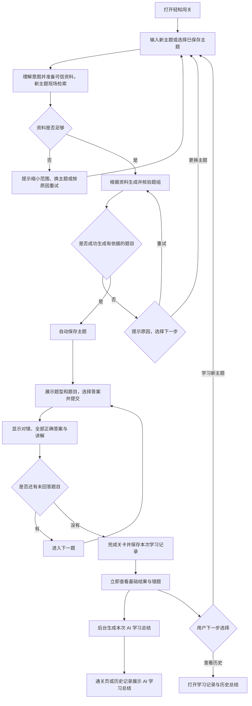

# 轻知闯关｜需求分析文档

> **产品名称：** 轻知闯关（暂定，名称可用性尚未核查）  
> **产品形式：** 微信小程序  
> **产品方向：** 泛学习，不预设具体学科或垂直领域  
> **文档定位：** 根据现有两份需求分析报告汇总，作为产品需求讨论和功能范围划分的依据。

本文中的 MVP 范围是根据“前期只做最核心功能”的要求提出的**建议范围**。文档、网页、视频等输入方式以及更丰富的学习分析仍然是原始需求，暂列为后续功能，并非取消。用户需求、学习效果、留存和付费意愿尚未经过真实用户验证。

## 一、需求背景

### 1.1 产品要解决什么问题

很多人有学习新知识的意愿，却容易遇到这些困难：

- 不知道从哪里开始，长篇资料读起来费力。
- 看过以后容易忘记，也不确定自己是否真正理解。
- 遇到错误时，只看到答案，缺少容易理解的解释。
- 可用于学习的时间零散，难以保持连续学习。
- 学过的内容缺少记录，之后想回顾时找不到重点。

轻知闯关希望把用户想学的知识整理成一组简短问答。用户通过**答题、查看讲解、总结和回顾**，更轻松地开始学习。

### 1.2 面向谁

面向想学习新知识的人，不限制于某个专业或固定人群。用户可能想了解感兴趣的话题，也可能希望围绕自己已有的文字资料进行自测。

“泛学习”指用户可以输入自己想学的主题。首版在收到新主题后理解学习意图，在线查找可信资料，并按资料生成练习。是否能出题取决于资料能否支撑一组完整练习。

### 1.3 为什么选择微信小程序

微信小程序无需单独安装，适合随时打开做一组简短练习，也便于再次进入查看学习记录。

### 1.4 竞品与产品机会

已有 [快出题](https://kuaichuti.net/)、[题答答](https://www.ti-dada.com/)、[Quizgecko](https://quizgecko.com/) 等产品提供资料出题、练习或报告等能力；通用 AI 工具也可以回答问题和生成题目。因此，单纯“用 AI 出题”不足以构成明显差异。

本产品值得验证的方向是：**让用户从自己的兴趣或材料出发，快速完成一组有依据、有讲解、能回顾的短练习。** 上述竞品信息来自公开资料，未逐一完整实测；产品差异和学习效果仍需用户验证。

## 二、MVP 最小可行功能点

### 2.1 MVP 目标与边界

**目标：验证用户是否愿意输入想学的内容，完成一组题目，通过讲解和总结回顾本次学习。**

首版只保留一条完整主线：

> 输入新主题或选择已保存主题 → 理解学习意图并准备可信资料 → 生成并核验题组 → 自动保存主题并开始答题 → 通关并保存学习记录 → 查看 AI 学习总结

通关页和历史详情先显示基础结果，AI 学习总结就绪后再展示。

用户可输入主题名或问题，例如「什么是 Vibe Coding？」。对于新主题，系统在本次请求发起后理解意图、提取检索词、搜索并核对相关资料，再异步生成一组有出处的练习。已有主题列表无需包含这个主题。主题确实有歧义或范围过宽时，提示如何缩小问题。资料不足时说明原因，搜索或生成暂时不可用时提供重试。

首页展示当前用户的「已保存主题」。「四季成因」和「月相变化」作为首版的初始示例，按已保存主题使用。新主题在整组题生成并核验成功后自动加入列表，即使用户还没通关也能在返回首页或重新进入小程序时看到；生成失败不新增主题。同一个规范主题重复出题只保留一个入口。点击已保存主题可再次生成练习。手动保存和用户管理模块暂不开发，主题归属沿用已有应用会话。

**后续扩展**包含学习材料粘贴及 RAG、生命值、好友分享、题目纠错反馈、隐私说明页面与学习记录删除、网页直接导入、文档和音视频解析、多人互动、付费、复杂学习分析及敏感词过滤。首版仍执行必要的平台内容安全检查；敏感词库过滤作为后续独立能力，不属于 MVP 主流程。

### 2.2 核心功能

| 序号  | 核心功能      | 用户可以做什么            | 首版范围                                                |
| --- | --------- | ------------------ | --------------------------------------------------- |
| 1 | 输入学习主题 | 输入自定义主题或问题，也可选择已保存主题 | 资料支持的领域均可尝试。内容为空、超限或确实需要缩小范围时给出相应提示 |
| 2 | 检索资料与生成题目 | 查找可信资料并生成一组练习 | 新主题现场检索。每组 20 题，包含单选、多选和判断题，每题包含正确答案、讲解和可查看的依据 |
| 3   | 逐题答题      | 选择答案并按顺序完成题目       | 一次展示一题，显示题型和当前进度 |
| 4   | 作答结果与讲解   | 提交后立即查看答题结果          | 显示正确答案、简短讲解和可查阅的对应依据                  |
| 5   | 基础学习结果    | 学完后立即回顾本次结果        | 展示主题、完成题数、答对题数、简要知识总结和错题 |
| 6   | 学习记录      | 查看以前完成的学习及总结       | 保存每次完成的主题、时间、答题结果和总结；支持再次打开查看                       |
| 7   | AI 学习总结 | 通关后回顾本次错题涉及的知识点 | 根据本次作答、题目讲解与已有依据生成知识回顾、易错点和复习建议。仅本人可在通关页和历史中查看 |
| 8 | 自动保存主题 | 回到首页选择曾成功出题的主题 | 题组通过核验后自动保存，重复出题只保留一个主题入口 |
| 9 | 查看出题进度 | 知道目前在做什么、已经等了多久 | 显示后台真实阶段和已用时间，返回首页后可继续查看同一任务 |

**题型与判分规则：** 一组 20 题，单选题、多选题和判断题各至少 1 题，其余题型由内容决定。无法生成满足要求且有依据的题目时，提示选择其他主题或重试。

- **单选题：** 用户从选项中选择 1 项并提交，所选项与唯一正确答案一致才算答对。
- **多选题：** 每题至少有 2 个正确选项；用户可选择多个选项，至少选 1 项后提交。所选项与全部正确选项完全一致才算答对，漏选或错选均算答错，首版不设置部分得分。
- **判断题：** 用户在“正确”和“错误”中选择 1 项并提交；选择与正确答案一致才算答对。
- 每题都标明题型；用户提交后立即显示全部正确答案、自己的作答及讲解，提交前可调整选择。每题只按首次提交判定一次，答错也必须显示讲解。

**关卡规则：** 每次提交后查看答案和讲解，再继续下一题。答完全部 20 题即通关，成绩只反映实际作答结果。

**题目可信度要求：** 优先选用与主题相关的官方文档、发布方原文、学术或权威机构资料。答案和讲解必须有实际取得的片段支持，用户可查看依据和出处。资料不足或资料之间的冲突影响正确答案时，提示缩小范围或换个主题。暂时性检索或生成故障可重试。

**质量优先：** 题组覆盖主题内不同考点，题干应清楚，正确答案必须明确，干扰项应合理但有可区分的理由，讲解应能说明为什么。逐题检查答案、讲解和依据的一致性，并检查重复题、歧义和虚构引用。可针对问题重新生成并核验；最终仍无法凑齐 20 道合格题时，整组标为失败，不以凑题换取成功。

**等待体验：** 提交后立即反馈，按实际阶段展示「理解主题」「查找和核对资料」「生成题目」「核验答案与讲解」，同时显示已用时间。等待较久时说明仍在哪个阶段，并提供「返回首页，稍后查看」。重新进入小程序后可查看当前会话的任务状态。预计耗时只有在实测足以支持范围时才展示。完成或失败均给出明确状态及下一步。

**保存与继续：** 题组生成成功即保存主题，答完 20 题才写入学习记录。中途退出后，可以从当前关卡第一题重新开始。跨会话续答列入后续功能。

**AI 学习总结：** 通关记录保存后自动生成，通关页先显示基础结果和生成状态。AI 根据本次题目和讲解概括知识重点，指出实际错题对应的知识点，并给出具体复习建议。全对时回顾本组重点并给出巩固建议。事实性内容可回看对应题目或已有依据，正确率仅反映本次作答表现。生成成功后保存到这次记录，并标注「AI 生成」。生成失败时基础结果仍可查看，可重试的失败会显示重试入口。

### 2.3 首版不追求的内容

- 不建设完整知识库、机构培训后台或专业考试系统。
- 不保证覆盖全部知识、所有资料类型或所有网页。
- 不设置排行榜、多人 PK、虚拟形象等复杂游戏机制。
- 不以完成一次选择题的正确率认定用户真实掌握程度。
- 不将生成内容用于正式考试认证或替代医疗、法律、金融等专业意见。

## 三、后续可以做的扩展功能点

### 3.1 优先级说明

- **P1：优先考虑。** 能够补足常见输入方式，或直接提升复习和学习体验。
- **P2：按用户需求验证后考虑。** 丰富学习方式、分享与商业化，但不是首版主线的必要条件。
- **P3：远期探索。** 适合在核心学习体验得到验证后，再评估复杂互动或特定组织需求。

优先级是当前建议。标为「待定」的功能已移出首版，后续按产品需要决定实现顺序。

### 3.2 扩展功能清单

| 优先级 | 扩展功能 | 需求说明 | 价值与考虑 |
|---|---|---|---|
| P1 | 网页链接学习 | 输入公开网页链接，读取允许访问的正文并围绕内容出题 | 减少手动复制；无法读取时应提供原因和粘贴文字的替代方式 |
| P1 | 文档学习 | 上传或选择有权使用的文档，围绕文档内容出题 | 满足使用已有资料的需求；具体支持格式和范围需另行确定 |
| P1 | 继续上次答题 | 退出后可回到未完成的关卡并继续作答 | 降低碎片时间学习的中断成本 |
| P1 | 错题再练 | 从学习记录中重新练习错题或同一知识点 | 帮助用户巩固不熟悉的内容 |
| P1 | 个人学习分析 | 按主题查看学习次数、答题情况及错题分布，支持生成更完整的复盘报告 | 帮助用户发现需要回顾的内容；结果只反映已有答题记录 |
| P1 | 学习内容调整 | 用户选择快速入门、深入理解，或调整题量与难度 | 适应不同学习目的；具体选项需要用户验证 |
| P2 | 视频或音频学习 | 围绕用户有权使用的视频、音频内容生成练习 | 丰富学习材料；需确认内容可获取、授权与质量 |
| P2 | 定期复习建议 | 根据历史学习和错题提出复习建议，用户可主动选择是否接收提醒 | 支持长期学习；提醒须符合平台规则及用户意愿 |
| P2 | 更换讲解方式 | 提供更简单的解释或生活中的例子 | 帮助用户理解难点 |
| P2 | 分享关卡与好友挑战 | 用户自愿分享可供朋友独立作答的关卡 | 丰富分享体验，需明确题目与资料的分享授权 |
| P2 | 图片与语音 | 根据知识内容提供题目配图或语音读题 | 满足视觉、听觉学习需求；应确认是否真正帮助理解 |
| P2 | 会员与付费 | 为额外学习次数或增值能力设计付费服务 | 商业化方向；收费内容和用户支付意愿尚待验证 |
| P3 | 知识库与组织学习 | 基于多份指定资料生成练习，支持团队培训等场景 | 用户与组织需求、权限和资料保护要求不同，需单独分析 |
| P3 | 多人 PK 与排行榜 | 多人比拼答题或参与排名 | 可能增加趣味，但需评估是否促进学习及用户是否愿意公开成绩 |
| P3 | 数字人与陪伴 | 通过虚拟形象或陪伴互动辅助学习 | 需要先验证用户是否需要及其实际价值 |
| 待定 | 可选生命值 | 可在开始前开启，答错扣除生命值，耗尽后可重开同组题 | 答错后仍展示本题正确答案和讲解 |
| 待定 | 好友只读分享 | 主动预览并分享主题和简短知识摘要 | 公开内容与私有作答记录、原始资料及个性化 AI 总结隔离 |
| 待定 | 题目纠错反馈 | 针对疑似错误的题目提交问题 | 便于按题目和依据复核，也可向用户显示提交结果 |
| 待定 | 学习材料粘贴与 RAG | 粘贴有权使用的学习材料，按本次出题需要检索相关片段 | 题目和讲解可引用原文依据，材料不足时提示补充 |
| 待定 | 隐私说明与记录删除 | 提供资料使用说明和学习记录删除入口 | 用户删除一条记录时一并移除关联 AI 学习总结 |
| 待定 | 敏感词过滤 | 在主题输入及生成内容等指定环节，按维护的敏感词库识别或拦截匹配内容 | 作为可独立配置的扩展能力；词库范围、误判处理和用户提示方式需另行确定，不替代平台要求的内容安全检查 |

## 四、用户操作的具体流程图

### 4.1 MVP 主流程

### 4.2 关键流程说明

1. **开始学习。** 输入主题或问题，也可直接选择已保存的主题。新主题先理解意图，再现场检索可信资料。
2. **出题与保存。** 一组 20 题通过核验后自动保存主题并进入答题。遇到歧义、资料不足或暂时性故障时，按原因提示缩小范围、换主题或重试。
3. **答题：** 单选题和判断题选择 1 项，多选题选择 1 项或多项。提交后查看对错、全部正确答案及讲解，再继续下一题。
4. **完成与保存：** 答完 20 题时保存记录，立即展示基础结果及错题。
5. **AI 学习总结：** 保存后自动生成。生成成功时在通关页和历史详情显示，失败时基础结果仍可查看，可恢复时允许重试。
6. **历史回顾：** 用户可查阅已完成的主题、基础结果和已经生成的 AI 学习总结。

## 五、需求功能清单

### 5.1 MVP 功能清单

下表是建议首版的检查清单；“完成标准”描述用户可以观察到的结果。

| 编号  | 功能模块  | 具体需求                      | 完成标准                              |
| --- | ----- | ------------------------- | --------------------------------- |
| M01 | 主题输入 | 输入自定义主题或问题，也可直接选择已保存主题 | 输入「什么是 Vibe Coding？」等新主题会进入检索流程；空内容、超限或意图确实不清时可按提示修改 |
| M03 | 主题资料 | 根据学习意图现场检索并核对可信资料 | 新主题有足够依据时进入生成；资料不足和临时不可用时分别提示 |
| M04 | 来源查看 | 展示题目及讲解可核对的依据 | 用户可查看真实资料片段、来源名称和链接 |
| M05 | 题目生成 | 生成一组 20 题，涵盖单选、多选和判断 | 三种题型各至少 1 题，多选题至少 2 个正确选项。每题包含题型、题干、选项、正确答案及讲解。无法满足时提示更换主题或重试 |
| M06 | 作答与进度 | 按题型选择并提交答案，显示进度 | 单选与判断选 1 项；多选至少选 1 项；提交前可修改，提交后记录首次判定 |
| M07 | 作答结果与讲解 | 提交后显示对错、用户答案及全部正确答案 | 每题都提供讲解；多选完全匹配才算正确，漏选或错选均算错误 |
| M08 | 关卡完成  | 答完全部 20 题即通关 | 展示完成状态和实际答对题数，答错也可完成本组练习 |
| M09 | 基础学习结果 | 通关后立即汇总本次知识重点与答题结果 | 展示主题、完成题数、答对题数、简要知识总结和错题 |
| M10 | 学习记录  | 保存并查看已完成的学习               | 用户可再次打开已完成记录，查看主题、时间、基础结果和已生成的 AI 学习总结 |
| M16 | AI 学习总结 | 通关后基于本次作答、讲解及已有依据自动生成个性化总结 | 本人可查看知识回顾、实际易错点和复习建议。全对时提供巩固建议。生成失败可重试，基础结果仍可查看 |
| M17 | 已保存主题 | 题组成功后自动保存主题，首页提供再次出题入口 | 成功且未答题也能在首页找到；刷新或重新进入后仍可见；同一主题重复出题只显示一张卡片；失败不新增主题 |
| M18 | 出题进度 | 展示真实阶段、已用时间和较长等待时的说明 | 离开等待页后可从首页查看同一作业；重新进入后不会重复提交；错误状态能说明是否可以重试 |

### 5.2 扩展功能清单

| 编号 | 功能模块 | 功能点 | 优先级 |
|---|---|---|---|
| E01 | 更多输入 | 网页链接学习 | P1 |
| E02 | 更多输入 | 文档学习 | P1 |
| E03 | 进度管理 | 继续上次答题 | P1 |
| E04 | 巩固复习 | 错题再练 | P1 |
| E05 | 学习分析 | 学习统计和更完整的复盘报告 | P1 |
| E06 | 个性化学习 | 学习方式、题量和难度调整 | P1 |
| E07 | 更多输入 | 视频和音频学习 | P2 |
| E08 | 巩固复习 | 复习建议和用户自主选择的提醒 | P2 |
| E09 | 个性化学习 | 更换讲解方式 | P2 |
| E10 | 分享互动 | 分享可供朋友作答的关卡 | P2 |
| E11 | 多媒体学习 | 图片与语音读题 | P2 |
| E12 | 商业化 | 会员与付费 | P2 |
| E13 | 知识库 | 多资料学习和组织培训 | P3 |
| E14 | 社交互动 | 多人 PK 与排行榜 | P3 |
| E15 | 陪伴学习 | 数字人与陪伴互动 | P3 |
| E16 | 闯关规则 | 可选生命值与耗尽处理，对应原 M14、M15 | 待定 |
| E17 | 好友分享 | 只读知识摘要，对应原 M11 | 待定 |
| E18 | 题目质量 | 题目纠错反馈，对应原 M12 | 待定 |
| E19 | 更多输入 | 学习材料粘贴与 RAG，对应原 M02 | 待定 |
| E20 | 隐私与记录管理 | 隐私说明页面和学习记录删除，对应原 M13 | 待定 |
| E21 | 内容安全扩展 | 独立的敏感词库过滤 | 待定 |

### 5.3 需要验证的关键问题

- **需求：** 用户会输入哪些学习主题？现场检索能为多少常见输入找到足够可靠的资料？用户是否会从已保存主题再次发起练习？
- **体验：** 用户是否能完成一组题，是否觉得讲解清楚、有用？
- **质量：** 题目、答案和依据是否准确？
- **复访：** 用户会不会主动回来看历史记录、继续学习新内容？
- **价值：** 用户相较于已有工具，是否认为这个体验更方便、更有帮助？

这些是首版需要观察的问题，不代表产品效果或商业价值已经得到证明。

---

**参考文档：** [深度需求分析报告](精通版本需求分析报告.md)；[泛学习需求分析报告（通俗版）](<轻知闯关：泛学习需求分析报告（通俗版）.md>)。两份原文保留；如原文中的特定领域建议与本次要求不一致，以本汇总文档的泛学习方向为准。
