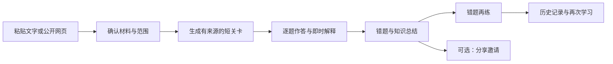

# AI 互动闯关学习小程序：竞品调研与需求分析报告

> 调研日期：2026 年 11 月 24 日（北京时间）  
> 调研范围：中国市场及微信生态为主，兼顾海外学习工具。  
> 项目阶段：创意验证；尚未进行用户访谈、产品实测或销售验证。  
> 决策用途：决定是否投入有限资源进行验证，以及第一版优先做什么。

## 一、执行结论

**值得进行低成本、限时验证；现在不值得直接投入建设“支持任何知识、任何输入和所有人群”的完整产品。**

理由有三：第一，主动回忆和反馈有学习科学依据，材料转练习也已有多个真实产品提供，说明方向有合理性，但不等于本项目已经获得用户需求或商业可行性的验证。第二，AI 出题、解析、报告、文件输入和分享并非空白市场；没有明确场景、质量和分发优势，很容易成为通用 AI 和成熟工具的替代品。第三，微信的便捷入口是机会，但平台审核、服务类目、分享规则与获客效率需要逐项实证，不能把微信用户规模等同于本产品流量。

**推荐的首个验证人群**：有明确考试、面试或职业学习目标，且已经拥有自己的文字笔记、培训材料或文章的成年学习者。更窄的第一批招募样本可以是**技术或产品岗位的面试准备者**：他们通常有较易获取的复习资料、较明确的知识范围和可触达的社群；这是便于独立开发者试验的假设，尚非已被证明最赚钱的人群。

**推荐的首个价值主张**：把自己正在看的资料，变成几分钟可完成、每题有依据、错题可再练的学习关卡。长期保留“学任何知识”的愿景，但先把“有资料、有目标、愿意复习”这条路径做扎实。

**建议顺序**：先通过人工服务和可点击样例验证痛点、题目质量与复习，再做小范围微信体验版。若目标是尽快验证“上传文档”需求，人工试验可以由研究者在授权范围内处理用户提供的文档；正式产品的首版先做文字粘贴和单篇可公开访问的网页，文件、视频以及全网搜索分阶段纳入。这个顺序是建议，不代表否定原始 MVP 的完整方向。

### 最关键的未知数

1. 用户会不会真实地带来第二份资料，或在几天后主动回来复习，而不是只觉得首次生成有趣？
2. 面对通用大模型、快出题及类似产品，用户为什么要多打开一个小程序？
3. 用户能否信任题目和解析？在来源错误、资料过期、信息不足时能否安全退出？
4. 单次有效学习的获取和生成成本，能否被留存、付费或机构采购覆盖？
5. 在具体主体、功能和运营方式下，小程序类目、模型使用证明和相关合规要求能否满足？

这些问题目前均**未验证**；本报告里的评分、价格、成本、指标门槛和周期均为决策假设，不是市场统计或预测。

## 二、原始需求理解与范围

用户希望：输入一句话、一段资料、文档、视频或网页；AI 从输入或网络信息中整理知识，自动生成带选项和答案的互动闯关；每题即刻反馈并解释；通关后形成总结、复盘报告和可分享内容；个人后台能回看知识和答题情况。后续考虑知识库/RAG、生图、VIP、多人 PK、排行榜、数字人和语音等，并希望能力能迁移到驾考、面试、企业培训等垂直方向。

这不是简单的题目生成器，而是一个围绕**资料输入 → 练习 → 解释 → 复盘 → 再学习**的学习体验。要注意：答题适合检索、辨析和应用练习，但并非所有知识都能充分用单选题学会，例如口语、设计、动手操作和复杂推理。不同内容需要不同练习方式，不能承诺“通过几道选择题学会任何知识”。

原设想中几项需要修正为可验证判断：

| 原设想 | 分析 | 当前判断 |
|---|---|---|
| 游戏化让学习更轻松 | 可能提升参与度，也可能使人只追求通关；需要对照验证 | 合理假设，未验证 |
| 每题及时解释能促进学习 | 反馈有助纠错，但错误或过度解释会损害体验 | 需要题目质量评审 |
| AI 全网搜集就能自动保证正确 | 搜索结果也可能过时、不一致、无法授权或不支持结论 | 不成立；应展示证据及不确定性 |
| 微信免安装就有大量自然流量 | 接入方便，但曝光、分享和复访均不是自动获得 | 渠道优势待验证 |
| 支持所有输入才能验证需求 | 不同入口对应不同解析、版权、合规和成本风险 | 先用较少输入验证主链路 |
| AI 生成总结和报告即可带来复盘 | 静态摘要未必带来行为变化；更重要的是下一次具体行动 | 用错题再练和回访数据验证 |

## 三、市场与竞品调研

### 3.1 证据与局限

本次主要通过 Chrome 阅读产品公开页面及政府原文，部分为官网自述，不能视为第三方验证。未登录、未购买、未逐一操作竞品；未在微信内对所有竞品实际扫码测试；未获取真实用户规模、转化率、留存率或财务数据。网页功能、价格和平台支持可能变化；下表的“未核实”不等于不支持。题喵喵是公开源码项目，不代表其功能和商业规模等同成熟商业竞品。由于浏览器安全策略，微信开放文档原页面未能读取，相关准入判断只能作为待核实事项。

### 3.2 核心竞品比较

| 产品 / 证据 | 类型及公开披露能力 | 关联与启示 | 公开信息的边界 |
|---|---|---|---|
| [题答答](https://www.ti-dada.com/) | 面向考试管理；官网称主题、文档、题库出题，AI 阅卷、报告，并展示小程序入口 | 与“AI 出题 + 报告 + 微信”直接重叠。面向学习者的低门槛复习体验或许还有机会 | 小程序中的具体 AI 功能、效果、宣称的客户数字与价格均未独立实测；官网当时称现阶段免费、专业版计划上线 |
| [快出题](https://kuaichuti.net/) | 官网称支持 Word、Excel、PDF、PPT 等资料生成题目、答案和解析；支持组卷、链接练习 | “文档变题”和练习链接已经存在。我们的差异要体现在个人学习闭环，而非输入格式数量 | 页面提供公开题库和客户评价，但学习效果、实际额度及微信小程序原生能力未核实 |
| [题喵喵 MiaowTest](https://github.com/qijun1900/MiaowTest) | 开源跨端刷题项目；文档列出多题型、错题、统计和 AI 相关能力 | 证明跨端刷题技术组合并不稀缺，可研究实现思路；不能据此推断其商业表现 | 仓库明确注明扫码体验小程序“平台限制 AI 相关功能未展示”；代码支持矩阵另有 AI 支持描述，线上实际状态以实测为准 |
| [Quizgecko](https://quizgecko.com/) | 面向学习者；官网称从笔记、PDF、网页、视频等生成练习、卡片和学习资料，支持查看来源及进度 | 资料驱动、来源核对、错题复习与手机学习都有成熟参照；“国外没有类似产品”不成立 | 官网自述免费计划每周 3 套；未注册验证地区、额度和各能力现状。官网显示用户数为营销自报 |
| [问卷星](https://www.wjx.cn/) | 在线调查与考试的广义替代品 | 微信分享、在线答题、统计是用户可选择的通用替代方案 | 未实测当前 AI 出题和个人复习能力，不能据此声称支持或不支持 |
| 通用大模型对话工具 | 用户可以要求生成选择题、解释和追问 | 最直接的免费或低切换成本替代品；产品必须节省整理、交互和复习的实际操作 | 不将特定产品当前功能、价格或服务资质泛化；需在实测中选定具体对照工具 |

**竞争格局判断**：资料出题、即时解析、报告和分享各自都不新；即便把它们组合，也未必足以形成壁垒。可能形成差异的组合是：**中文场景下的可追溯题目 + 轻量微信体验 + 实际发生的错题再练 + 可带来第二个学习者的分享**。这些是产品假设，不是已经验证的竞争优势。

### 3.3 用户可能如何替代我们

- **只想快速弄懂一个知识点**：直接问大模型，免于创建关卡。
- **已有成熟考试题库**：使用考试宝、驾考类产品或课程自带题库；这些场景往往依赖授权、稳定和紧贴大纲的题源，AI 随机生成不天然占优。
- **老师或机构需要考试管理**：使用题答答、问卷星等，组织管理和考核能力更成熟。
- **希望从材料生成题卡**：使用快出题、Quizgecko 等已有工具。
- **有自己的复习习惯**：使用笔记、卡片、聊天群或手工自测。这里的切换成本也不能忽略。

因此在访谈时，应要求用户用自己的真实资料完成同一任务，观察他们会选择哪种现有工具；不要只问“你觉得这个想法好不好”。

### 3.4 学习科学能支持什么

Roediger 和 Karpicke 的记忆测试研究发现，在该研究条件下，练习回忆可以改善之后的保持，支持将“回忆”作为学习设计候选机制：[Test-Enhanced Learning, 2006](https://pubmed.ncbi.nlm.nih.gov/16507066/)。这项研究**不能直接证明** AI 生成选择题、游戏化或本产品能提高所有人的学习效率；它为产品实验提供理论依据，而不是效果证明。后续应通过延迟测试、题目质量和真实任务表现验证。

## 四、目标用户、场景与定位

### 4.1 候选方向比较

以下为 1–5 分的主观假设分，5 为更有利；各维度等权求和，目的是帮助优先试验，不代表调研测量。获客可及性默认开发者能触达中文职业社群，若实际渠道不同，排序应调整。

| 方向 | 痛点频次/紧迫度 | 用户自带材料 | 获客可及性 | 质量与合规可控性 | 付费可能性 | 合计 | 备注 |
|---|---:|---:|---:|---:|---:|---:|---|
| 技术/产品面试与职业知识复习 | 4 | 4 | 4 | 3 | 3 | 18 | 推荐首试；竞争强，考试周期有峰谷 |
| 泛兴趣与通识学习 | 3 | 2 | 3 | 2 | 2 | 12 | 范围大，兴趣驱动易浅尝辄止 |
| 单一资格考试 | 5 | 4 | 3 | 2 | 4 | 18 | 需求明确，但真题版权、准确性、更新及头部题库竞争压力高 |
| 企业培训组织者 | 4 | 5 | 2 | 2 | 4 | 17 | 付费潜力可能较高，但采购、权限、隐私与交付周期更重 |
| 驾考 | 5 | 2 | 3 | 2 | 3 | 15 | 成熟大平台与标准题库优势显著，不宜先正面竞争 |

建议以**职业知识/面试复习**为研究招募边界，同时记录用户来自具体学科、备考阶段和材料类型。若开发者实际更容易触达企业培训负责人，应将其作为独立实验组，而不是提前把 B 端需求混进同一套 MVP。是否选定该切口，取决于访谈、行为和获客数据。

### 4.2 首批用户画像与任务

- **主要用户：成年自学者/求职者。** 有一份面试笔记、文章或知识清单；希望知道自己哪里没有理解，并能在通勤或等候时再练。
- **触发时刻：** 读完一篇文章、整理完一次面试笔记、临近复试，或者被朋友分享一份适合自己练习的关卡。
- **核心任务（JTBD）：** 当我刚读完一份资料时，帮我快速发现自己是否理解，并准确指出要回看的位置；下次只有几分钟时，能继续练之前不会的内容。
- **成功信号：** 用户完成练习后能指出自己理解变化，并在另一时间自主再次练习；而不仅是对答案产生“很有趣”的评价。
- **非首期重点：** 未成年人、正式能力认证、医疗法律金融等高风险决策、企业绩效考核；真实存在的需求应另行评估。

## 五、产品方案与 MVP 建议

### 5.1 三个可行方向

1. **通用主题探索型**：输入主题，联网搜集信息并闯关。优点是入口最轻；缺点是知识边界、来源质量与时效性最难控制，差异化也不明确。
2. **自带资料复习型（推荐首试）**：粘贴材料或输入可公开访问的单篇网页，生成可追溯的短练习和错题复习。输入更费一步，但知识边界清楚、便于质量评估，适合明确的学习任务。
3. **组织培训考核型**：管理员上传标准材料、审核题目、分发并查看团队结果。可能更容易证明组织价值，但需多人权限、隐私协议、采购与管理员工作流，不适合与 C 端同时作为首期目标。

上述是研究建议，尚未通过用户选择或实验确认。

### 5.2 推荐的首版用户流程

1. 选择“粘贴资料”或“公开网页链接”；也可打开预置示例直接体验。
2. 确认材料标题、截取范围和学习目标；提示敏感资料不应输入，并说明数据会如何处理。
3. 系统生成约 5–8 道单选练习；对内容不足或解析失败给出原因与重试入口，不虚构内容。题量是待测试参数。
4. 每题选择后显示正确/错误、简短解释、来源片段或对应位置；能标记“题目有问题”。
5. 通关页显示已回答数量、错题和关键知识点，提供“再练错题”和来源回看；对于信息不足的结论明确标记。
6. 显示个人历史及可继续的练习；分享时默认仅分享经允许的关卡邀请，不包含原材料、私有结果或身份信息，接收人无需看到创建者的答案。

以 Mermaid 表示：

### 5.3 功能优先级与验收条件

| 优先级 | 需求 | 首版验收条件 / 边界 |
|---|---|---|
| P0 | 文本输入与示例 | 用户能粘贴非空文本、使用示例；超长和不足内容有清晰提示；输入上限由试验和成本决定 |
| P0 | 单篇公开网页 | 仅解析无需登录且允许访问的公开网页；失败或正文不足时可改用粘贴；不声称覆盖所有站点 |
| P0 | 题目生成 | 每题包含题干、4 个选项、唯一正确答案、解析、可定位的依据；生成失败可重试且不重复扣除配额 |
| P0 | 作答反馈 | 提交选项后立即显示正确答案和解释；重新进入可恢复已提交状态，避免重复计分 |
| P0 | 复盘与错题 | 完成后展示本次结果、关键点及错题；至少支持再练一次并记录结果。正确率表述为“本次题目答对比例”，不等同真实掌握程度 |
| P0 | 可追溯及反馈 | 能看到题目所依据的材料片段/位置；用户可报告错误；输入资料、答案、版本关联可追查 |
| P0 | 数据与安全 | 最小必要身份与记录；清晰告知数据处理、删除路径；生成/分享内容审核与举报、服务配额、故障处理可用 |
| P0 | 分享 | 用户明确主动分享；默认不暴露原文、学习记录和身份；接收者能打开可访问的内容或看到失效说明。是否允许分享题目及引用需结合授权与平台规则 |
| P1 | PDF/DOCX 上传 | 先做可提取文本的有限大小文件；扫描件和复杂表格明确不保证。应基于原始需求尽快做人工试验验证，而非默认永久排除 |
| P1 | 自由主题与检索 | 只使用有清晰来源的检索结果；展示来源、时间和不确定性；无可靠来源时拒绝生成或要求提供材料 |
| P1 | 复习安排 | 根据错题和复习时间给出建议；提醒需要用户同意且遵循平台消息规则，不承诺固定频次触达 |
| P1 | 个人分析 | 按练习次数、近几次正确率和错题类别展示，样本小或题目少时不输出“能力诊断” |
| P2 | 视频、音频、RAG 知识库 | 先检验授权、可访问字幕/转写质量、成本；企业数据隔离和多文档治理另立项 |
| P2 | 生图、语音、PK、排行榜、数字人、VIP | 保留方向；需分别证明学习或商业价值，避免在留存证据前增加成本和复杂度 |

这里的 P0 是**建议首版**，比原始设想中的输入范围更窄。文档、视频和联网检索仍是重要需求，按验证顺序分阶段，不应在对用户的宣传中声称第一版已支持。

### 5.4 产品亮点候选

| 候选 | 用户价值 | 最小实现 | 主要验证方式 |
|---|---|---|---|
| **答案可追溯** | 知道解释从何而来，便于纠错 | 每题关联资料片段，标注“依据不足” | 抽样检查可定位率和支持率；观察用户是否点击 |
| **错因再练** | 把错误转成下一步 | 按错题原知识点出一道不完全相同的新题；避免只背答案 | 比较同义新题正确率和延迟测验 |
| **一份资料，多次短练** | 把长文拆成几次可完成的任务 | 用章节/知识点切分并保存进度 | 看第二次、第三次自发打开比例 |
| **好友挑战题** | 让分享对象也有学习理由 | 仅分享获授权的题组邀请，不展示创建者隐私 | 衡量有效到达和独立完成，排除自点 |
| **不确定就停** | 避免把猜测包装成标准答案 | 无依据不出题或明确要求补充材料 | 人工抽检错误/缺依据比例 |
| **学习迁移小题** | 从记住一句话走向能应用 | 对适合材料生成一个轻量情景题 | 对照单纯事实题的延迟应用表现 |

这些均非已经证实的独创功能，也不应承诺显著提高成绩。先选 1–2 项做对照，不要一次性加入所有机制。

## 六、题目质量与内容可信度

### 6.1 题目生成规则

- **材料优先：** 按用户确认的资料出题，区分“资料中明确说明”“推断”与“外部信息”；首版不把模型记忆伪装为资料。
- **引用可检查：** 保存材料版本、片段与位置；引用只能说明资料支持答案，不等于资料本身正确或最新。外部来源应记录标题、链接和获取时间。
- **结构检查：** 限制题型、选项数、重复项、答案范围、解释和引用字段；单选题确保在给定前提下只有一个最优选项。
- **语义检查：** 交叉检查题目、选项、答案与证据是否一致；自动检查不能取代人工。存在时间、地域、版本差异时写明适用条件。
- **反馈治理：** 用户标记问题后记录原题及版本，隐藏或暂停扩散有争议题目；重生成保留旧记录，防止成绩被悄悄改写。
- **危险或不适合内容：** 未经专业验证，不将生成结果用于医疗、法律、金融决策及正式资格认定；对违法、不适宜或侵权材料采取平台及服务政策要求的处理。

### 6.2 人工评估方案

首轮挑选 10 份用户授权的不同资料，每份生成 10 题，共 100 题；至少一名有相关领域基础的评审按题独立标注，争议题复核。记录抽样来源和不一致，不能把 100 题外推为全领域质量。

| 指标 | 定义 | 首轮建议门槛（假设） |
|---|---|---|
| 答案正确率 | 答案与材料、适用条件一致的题数 / 已评题数 | ≥95/100；高风险领域不使用此门槛放行 |
| 证据支持率 | 引用真实存在且足以支持答案的题数 / 已评题数 | ≥95/100 |
| 无歧义率 | 答案唯一且题干条件充分的题数 / 已评题数 | ≥90/100 |
| 严重误导 | 错误可能造成明显现实损害或严重误学的题数 | 0；发现立即停止对应场景并复核 |
| 报错处理 | 反馈被记录、可复现并能暂停该题分享 | 全链路跑通 |

100 题只用于早期排雷，不代表真实错误率精度足够。材料本身错误、非代表性抽样和评价者能力都会影响结论。即使达到门槛，也需持续抽查。

## 七、商业可行性与单位经济模型

### 7.1 收费方向

- **个人用户：** 免费体验少量关卡，验证后再测试按量包或月度订阅。可能的付费价值是更多资料、可靠复习和跨设备保存，不是单纯“AI 多生成几次”。
- **机构用户：** 在出现真实采购需求后，独立验证基于审核、权限、知识更新和组织分析的服务；不应把个人会员价格直接套用给机构。
- **建议价格实验：** 向符合条件的访谈用户测试例如 9.9 元体验包、19–39 元/月两个区间；这些仅是测试选项，不是竞品价格、用户支付意愿或推荐最终定价。严格区分口头愿意、留下联系方式、主动预付和实际续费。

### 7.2 示例成本（不是供应商报价）

假设一名月活用户每月产生 4 次新关卡；每次关卡变量成本：模型 0.06 元、网页获取与解析 0.02 元、存储及其他变量成本 0.02 元，共 **0.10 元/次**。另假设每月固定费用 500 元、活跃用户 1,000 人、全部新关卡均成功：

- 生成变量成本：1,000 × 4 × 0.10 = **400 元/月**。
- 加固定费用：400 + 500 = **900 元/月**，平均 0.90 元/月活用户；未含人力、营销、税费、支付手续费、审核、额外存储、重试及风控。
- 如付费比例 5%，每付费用户实际月净收入 19 元，则收入 1,000 × 5% × 19 = **950 元/月**，上述简化毛额差 50 元，不足以支持人力和获客。
- 极端压力：单次变量成本从 0.10 上升到 0.30，生成变量成本变为 **1,200 元/月**；加固定费用合计 **1,700 元/月**，在其他假设不变时为负。

应记录每次请求的输入/输出 token、模型、重试、搜索及解析费用、调用成功率、缓存命中、活跃与付费情况；然后使用**实际供应商账单**替换假设。分别计算每个完成关卡成本、每个 7 日回访用户成本和每个付费用户获客成本。高消耗、多次重试、恶意调用与大文件会明显改变结果。

## 八、验证方案与决策门槛

### 8.1 先访谈，再用行为试验

**第一阶段：问题访谈，约 12–15 人。** 招募真实准备面试/职业考试且过去 30 天整理过材料的人，尽量覆盖不同备考阶段；至少一半来自非熟人渠道。预先记录招募条件及未响应数。不要给被访者暗示“游戏化一定有效”。

问题示例：

1. 最近一次需要记住一份资料是什么时候？最终怎么复习的？能否展示实际材料或过程？
2. 上一次遇到不会的内容，你使用了哪些工具，花了多久？最不满意的是什么？
3. 什么时候会重新回来复习？哪些情况会放弃？
4. 目前为学习工具付过什么钱？为什么付或没付？
5. 如果今天就能把这份资料变成练习，你愿意现在拿真实资料尝试吗？为什么？

访谈只形成定性假设，不用 15 人推出市场规模或付费率。

**第二阶段：人工辅助闭环，目标 20–30 名符合条件用户。** 在得到每位参与者对材料使用的明确同意后，使用真实材料、人工审题和轻量原型，交付一次练习、解释和错题再练入口；记录每个环节耗时及退出原因。不要在未经授权的情况下将私人或企业材料发送至第三方模型。招募者、出题者和评审角色尽量区分，至少保留原始记录。

建议设置同任务对照：对照组用用户平时的方式或选定的通用 AI 工具，实验组使用资料驱动短练；若样本不足，先采用随机顺序的交叉体验来发现可用性问题，不声称具有统计显著性。

**第三阶段：小范围体验版。** 在题目质量、隐私方案与微信准入初步可行后，开放给第一批用户使用，观察复访、分享和成本，再决定是否扩展文件、主题搜索和人群。

### 8.2 事先约定的指标口径

以下门槛为**试验决策阈值而非行业基准**，样本小需同时查看原始人数、置信区间和定性原因；不要只汇报百分比。

| 关键假设 | 指标与分母 | 建议试验阈值 | 未达标时 |
|---|---|---|---|
| 输入有足够价值 | 提供真实资料并开始生成的人 / 符合招募条件且完成引导的人 | ≥60%，目标样本 20–30 | 找出隐私、输入成本、需求不紧迫等原因 |
| 首次练习能完成 | 首次成功生成后完成 ≥5 题的人 / 首次成功生成的人 | ≥70%，同时报告生成失败人数 | 修复等待时间、题目质量、题量；不要仅靠更少题刷高比例 |
| 用户愿意再来 | 首次完成者中，第 7–14 天主动完成一次有效练习的人 / 可观察满 14 天的首次完成者；不含研究者代操作 | ≥25% 作为继续调查线索 | 访谈流失；区分考试周期和产品问题。发提醒者单列，与未提醒者不混算 |
| 学习有效果 | 同一材料的延迟新题正确率，与基线或对照条件比较；预先约定题目难度和顺序 | 先验证测量可行，不对小样本预设显著提升 | 优先查题质和题目难度；无法排除记忆原题则不宣称学习提升 |
| 分享有意义 | 独立接收者完成 ≥5 题人数 / 发起分享的独立用户数；另记分享点击到落地成功率 | 无预设达标值；先验证归因与隐私 | 降低依赖分享获客的预测，寻找社区或内容渠道 |
| 支付意愿 | 明确条件下真实支付人数 / 看过价格且符合条件的人；区分退款和复购 | 先观察实际支付，不将口头意愿当收入 | 回到付费价值和目标用户选择 |
| 质量与安全 | 按第六节抽检及严重问题记录 | 达到约定质量门槛，严重问题为零 | 暂停相应场景并修复，不靠增长抵消质量问题 |

**早期北极星候选**：每周完成至少一次**有来源练习，并在之后再次完成一组练习**的独立用户数。早期该指标增长也可能由运营提醒或招募带来，应按自然回访、研究者提醒和付费渠道拆分；它衡量行为，不直接证明知识掌握。

### 8.3 停止、调整与继续

- **继续：** 用户真实带来材料、练习完成和自主回访呈现正向迹象，人工质量抽检过线，单位成本有可行路径，且微信准入有明确推进方案。
- **调整：** 首次完成好但回访差，尝试聚焦考试日期更明确的人群，或者改进错题价值；输入完成低则检验文件入口、隐私顾虑和材料准备成本。
- **暂停：** 出现严重内容误导、无法合法处理材料、平台准入不可行，或连续试验都无法找到可重复触达和复习的用户。暂停意味着重新界定问题，不意味着学习产品赛道不存在。

## 九、增长和分发

### 9.1 渠道实验

1. **社群与内容合作：** 在确有目标用户的技术/产品面试社区，以可验证的示例题和复习方法介绍产品；仅在群规允许且获得必要授权时发布，避免把垃圾分享当增长。
2. **现有关系传播：** 用户主动邀请同伴挑战同一份已授权题目；被邀请人体验要独立完整，不要求先公开自己的得分。
3. **可检索示例内容：** 公开仅使用自有、授权或可合法使用的材料，示例应提供来源及更新日期。不要将私人资料自动公开为题库。
4. **机构试点：** 若有现成渠道，另行访谈培训负责人，围绕题目审核、参与率与材料维护开展小试，不提前承诺绩效判断。

渠道指标分别记录曝光、落地、开始、生成成功、首次完成、7–14 天回访、获客投入和付费；同一人去重，分别看自然和付费渠道。微信分享链路、分享卡片、接收人打开及合规约束均需在对应账号和终端实测。

### 9.2 分享边界

默认私有；清晰区分“分享邀请”“分享题目”“分享成绩”。原文和解析可能受版权、个人信息或商业秘密约束，未经授权不复制到公开页面。默认不显示用户头像、姓名、原始文档、完整答题记录或得分；链接可以撤销或过期。不要以强制转发、诱导分享解锁答案作为默认方案，具体平台规则上线前核查。

## 十、实现与运营约束

### 10.1 最小系统能力

- **小程序端：** 输入、生成状态、逐题作答、反馈、结果与历史、主动分享。
- **服务端：** 用户与权限、任务队列、材料解析、生成编排、数据存储、频控、内容审核、反馈处理及日志。
- **知识处理：** 正文抽取 → 分段和知识点 → 生成题目与引用 → 格式/一致性校验 → 结果入库；需保留生成版本和来源。
- **最小运营后台：** 查看故障与匿名聚合数据、处理用户报告、暂停问题题目、配置配额；个人用户的“学习记录”属于用户端能力，不等同运营后台。
- **失败状态：** 网页无法解析、来源不可达、资料太少、生成超时、内容不合适、网络中断时，明确告知并提供重试或替代路径；不得返回看似成功的空结果。
- **安全：** 网页抓取应防止访问内网地址、重定向滥用和超大响应；用户文件限类型大小、隔离访问并限定保留时间；服务端保护密钥、限制调用和记录异常。以上为需求级要求，不构成完整安全设计。

### 10.2 合规与平台风险

- 国家网信办《[生成式人工智能服务管理暂行办法](https://www.cac.gov.cn/2023-07/13/c_1690898327029107.htm)》对面向中国境内公众提供生成式 AI 服务的适用范围、个人信息、内容治理等提出要求；第 17 条对具有舆论属性或社会动员能力的服务规定安全评估及备案要求。**具体主体、场景与义务是否适用，需要基于实际方案核实，不能一概说所有应用都必须自行备案，也不能说调用已备案模型即可自动免责。**
- 网页、文档和视频可能涉及版权、用户个人信息、商业秘密和第三方平台规则；抓取公开可访问内容不自动意味着可以复制、传播或用于任何用途。应提供授权确认、隐私说明、删除及投诉流程，并对来源和共享范围作限制。
- 微信服务类目、主体资质、AI 相关证明、备案或登记及内容审核要求必须以上线时官方后台、适用法规和具体主体核验。浏览器安全策略阻止直接查看微信开放文档，因此本报告**没有核实适用于本项目的具体类目或材料清单**；题喵喵的公开体验说明只能作为风险线索，不代表微信对所有 AI 功能一律禁止。
- 若处理未成年人信息、对公众提供特定领域服务、使用消息推送、上线支付、处理跨境数据或 AI 合成内容，可能引入额外要求。上线前根据实际产品、所在地规则和平台要求专项核实，必要时咨询专业人士。

### 10.3 粗略排期与依赖

以 1 名具备小程序、后端和模型接入经验的开发者为示例，以下仅供规划，不包括平台审核等待，具体需要按真实资源调整：

| 阶段 | 假设用时 | 产出及依赖 |
|---|---|---|
| 问题访谈和竞品手动体验 | 1–2 周 | 12–15 人访谈记录、同任务替代品观察、招募渠道评估 |
| 人工辅助原型与题质评估 | 1–2 周，可与访谈后半段交叠 | 20–30 人体验、授权材料、100 题质检、初步成本数据 |
| 限定功能体验版 | 3–5 周 | P0 主链路、数据和安全基础；依赖平台主体、服务接入、材料授权与类目核验 |
| 14 天留存观察 | 上线后至少 2 周 | 完整 cohort、复访、质量、成本和决策复盘 |

不能把这些阶段简单相加为承诺发布日期；招募、模型选择、材料复杂度、审查和个人可用时间都会改变计划。

## 十一、建议的下一步

1. 找 12–15 名近期准备面试或职业复习的成年人，收集真实经历并确认能否提供不含敏感信息的材料。
2. 选一个明确知识范围，手工制作 3 组示例：每组含资料、5–8 道题、逐题解析和可定位依据，先让用户独立体验。
3. 让参与者使用当前惯用工具完成同一任务，记录时间、质量、信任、是否愿意再次使用及退出原因。
4. 并行核实微信主体、类目和 AI 接入材料；直接向官方后台或服务商核验项目的具体能力，不以单篇博客结论代替。
5. 按第六节抽检题目，按第八节观察完成和复访，再决定进入小程序开发或调整场景。

## 十二、来源及证据分级

以下来源于 2026-11-24 访问或检索；产品官网功能与价格可能变化。**A** 为官方原文/原始研究，**B** 为产品自身披露或开源项目自述；B 类可以证明其公开宣称，不足以证明真实效果、用户数或商业表现。

1. **A** 国家网信办：[生成式人工智能服务管理暂行办法](https://www.cac.gov.cn/2023-07/13/c_1690898327029107.htm)——适用范围和服务义务的原文；本报告仅作风险识别。
2. **A，摘要检索可见** Roediger & Karpicke：[Test-Enhanced Learning: Taking Memory Tests Improves Long-Term Retention](https://pubmed.ncbi.nlm.nih.gov/16507066/)——主动回忆的研究依据；浏览器打开论文页面时受访问限制，研究结论以可见摘要和标题为限。
3. **B** [题答答官网](https://www.ti-dada.com/)——主题/文档出题、考试管理、报告和小程序入口；数据及商业宣称未经独立核实。
4. **B** [快出题官网](https://kuaichuti.net/)——文档类型、出题、题库和练习；未实操验证。
5. **B** [题喵喵开源项目](https://github.com/qijun1900/MiaowTest)——跨端功能及其对线上小程序 AI 展示限制的自述；仓库内部不同描述需实测澄清。
6. **B** [Quizgecko 官网](https://quizgecko.com/)——资料输入、练习、来源与免费计划的官方自述；未登录实测。
7. **B** [问卷星官网](https://www.wjx.cn/)——在线考试和问卷类替代方案；当前具体 AI 功能未实测。

**证据缺口：** 没有可信的细分市场规模及增速、独立竞品留存/营收、微信入口转化、用户支付数据和本产品学习效果数据。不能由上述资料推断目标市场规模、产品成功概率或预计收入；需要用后续访谈、受控试验和真实运营数据补齐。
